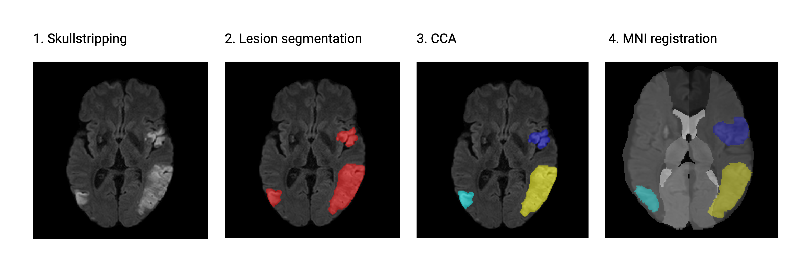

## Automated quantification of stroke lesion distribution from brain MRI



This github repository allows automated quantification of stroke lesion distibution based on brain MRI using DWI, ADC and FLAIR sequences. It does so by combining different existing tools to perform skullstripping, stroke lesion segmentation, identification of individual stroke lesions and registration to MNI atlas space. We use a vascular territory atlas and an anatomical atlas linked below to quantify stroke lesion distribution **but the pipeline works with any MNI152 atlas**. Details can be found in the paper:

```
add mansucript
```
 
## Contents:
- [Installation](#installation)
- [Downloading template and atlases](#downloading-template-and-atlases)
- [Running Pipeline](#running-pipeline)
- [Extracting Features](#extracting-features)
- [Citing this and underlying works](#citing-this-and-underlying-works)
- [Questions](#questions)


## Installation

First clone this repository. We recommend creating a dedicated conda environment and installing the packages there

````console 
git clone https://github.com/jul-des/stroke-lesion-processing.git
cd stroke-lesion-processing
conda create -n stroke-pipeline python=3.10 -y
conda activate stroke-pipeline
pip install --upgrade pip
pip install -r requirements.txt --extra-index-url https://download.pytorch.org/whl/cu121
````

Further, the pipeline relies on the DeepISLES docker for stroke lesion segmentation. You will have to download Docker and the NVIDIA Container Toolkit. Then you can download the docker image by running ```docker pull isleschallenge/deepisles```. Details on installation of the DeepISLES docker image can be found under https://github.com/ezequieldlrosa/DeepIsles#docker

## Downloading template and atlases

The MNI152 FLAIR template used in this pipeline can be downloaded from https://zenodo.org/records/3379848. We use the caa_flair_in_mni_template_smooth_brain_intres.nii.gz template.

Any brain atlas in MNI152 space can be used in comnbination with our pipeline. 
For our analyses we use a vascular territory atlas that can be downloaded from https://www.nitrc.org/projects/arterialatlas. We use the Level 2 atlas for our analyses, Level 1 provides more detailed vasular territories.
Further we use the Harvard Oxford Atlas for identification of cortical lesions. To download it simply run 

````python 
from nilearn.datasets import fetch_atlas_harvard_oxford
fetch_atlas_harvard_oxford('cort-maxprob-thr25-1mm', data_dir = '/path/to/atlas/')
````
We use the HarvardOxford-cortl-maxprob-thr25-1mm.nii.gz atlas in our analysis.

## Running Pipeline

To run the pipeline, a masterfile is required. This masterfile should contain columns Patient ID, Path dwi, Path adc and Path flair containing unique patient IDs and paths to DWI, ADC and FLAIR images for each patient. The MRI images should be in nifti format. Optionally, if data from multiple centers is present, the center each patient belongs to can be specified in a column called Center.

You can then run the run_pipeline script to run the pipeline. Simply add the path to the masterfile, the path to the FLAIR MNI152 template and the path to any MNI152 atlas (used for automated quality control) as well as the output directory at the top of the file and run it. You can also specify a path to the tmp directory that should be used. As ANTS (used for registration) sometimes does not delete all tmp files, setting the tmp directory allows for easy manual deletion, should tmp files accumulate. 

Within the output directory, the pipeline will create a subdirectory per center (if specified) and a folder per patient. It will return skullstripped DWI, ADC and FLAIR sequences in native space (suffix: _bet) as well as DWI and FLAIR in native space (suffix: _mni). In a subfolder "masks" it will return brain masks of FLAIR and DWI/ADC in native space. Further it returns a binary stroke lesion mask (suffix: lesion_msk, no lesion: 0, lesion: 1) and a mask containing individual stroke lesions derived through 3D CCA (suffix: _lesion_components, no lesion: 0, lesions: 1-n) both in native and mni (suffix: _mni) space. It also returns a screenshot of the stroke lesion segmentation. 

Finally, the pipeline calculates DICE scores for the overlap of FLAIR and DWI brain masks with the atlas mask in MNI space as well as the fraction of stroke lesions within the atlas mask in MNI space and outputs this in a file called qc_metrics. If no stroke lesions are detected or if skullstripping fails, the pipeline will print this to the terminal and then skip further processing in these patients. The qualitiy control values will be NA if no lesions are detected. 

**Important Notice:** When the run_pipeline.py script is run, it checks for any cases that have already been completed by checking which patients already have folders in the output directory and will skip these patients. Hence, if you would like the pipeline to re-run a patient or if the pipeline was interrupted in the middle of analysing one patient, simply remove that patient's folder from the output directory and the pipeline will process that patient again.

## Extracting Features

Once the pipeline has been run, the stroke lesion masks can be used to extract features on stroke lesion shape and distribution using the extract_features notebook under the feature_extraction directory. Details can be found in the notebook.
Depending on the feature extraction method used, you might receive per lesion features, with potentially multiple lesions per patient. To aggregate these per lesion features to the patient level you can use the aggregate_features notebook under the feature_extraction directory.

## Citing this and underlying works
This pipeline builds on multiple preexisting tools. When using this pipeline please cite all of the below: 

```
add manuscript
```

Skullstripping:
```
Isensee F, Schell M, Tursunova I, Brugnara G, Bonekamp D, Neuberger U, Wick A,
Schlemmer HP, Heiland S, Wick W, Bendszus M, Maier-Hein KH, Kickingereder P.
Automated brain extraction of multi-sequence MRI using artificial neural
networks. Hum Brain Mapp. 2019; 1–13. https://doi.org/10.1002/hbm.24750
```

Lesion segmentation: 
```
de la Rosa, E., Reyes, M., Liew, SL. et al. DeepISLES: a clinically validated ischemic stroke segmentation model from the ISLES'22 challenge. Nat Commun 16, 7357 (2025). https://doi.org/10.1038/s41467-025-62373-x
```

MNI FLAIR template:
```
Schirmer, Markus D., et al. "Spatial signature of white matter hyperintensities in stroke patients." Frontiers in neurology 10 (2019): 208.
```

If you use the vascular territory atlas please cite:
```
Liu, CF., Hsu, J., Xu, X. et al. Digital 3D Brain MRI Arterial Territories Atlas. Sci Data 10, 74 (2023). https://doi.org/10.1038/s41597-022-01923-0
```


## Questions
Inquiries can be directed to julian.deseoe@uzh.ch
